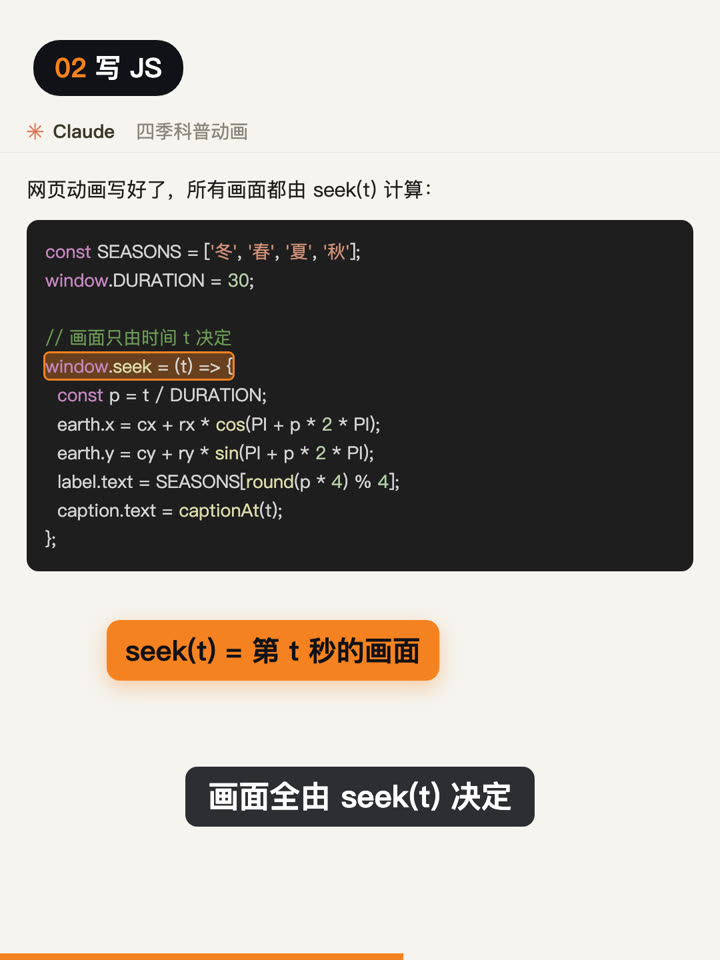

最近小红书上有很多科普动画，画面干净，节奏也卡得很准。看了一篇讲 Claude 做视频的文章才知道，这类视频很多是 AI 直接写代码做出来的。我照着试了一遍，做了下面这条 30 秒的视频。画面、字幕和配乐都是代码生成的，我一帧都没画。

<a href="/assets/posts/ai-video-without-drawing-a-frame/video.mp4"></a>

点击图片播放视频。视频里的 Claude 界面、终端和文件夹是用代码模仿的示意图。

## 视频其实是一个网页

关键在一个函数 `seek(t)`。网页里所有画面都由它算出来：给它第几秒，它就画出那一秒的样子，不看真实的时钟。



有了它，浏览器就可以依次调用 `seek(0)`、`seek(1/30)`、`seek(2/30)`……每调一次截一张图。30 秒、每秒 30 帧，一共 900 张，最后用 FFmpeg 拼成 MP4。

因为画面只由时间决定，同一份代码每次渲染出来都一样。想改一句字幕，改完重新渲染就行，不用回到时间轴上一点点拖。

## 三步

1. 写脚本。先把每个镜头几秒开始、几秒结束、屏幕上写什么定下来，后面的画面和字幕都跟着这张表走。
2. 写 JS。让 AI 按脚本写一个 HTML 动画，所有画面都由 `seek(t)` 计算。
3. 渲染。用无头浏览器逐帧截图，再用 FFmpeg 合成视频，配音和配乐也在这一步加进去。

不想分三次说的话，一句话也够：

```text
做一条 30 秒 3:4 竖版科普动画，主题「为什么会有四季」：先写带时间点的分镜，再写成一个 HTML 动画，画面全由 seek(t) 决定，最后逐帧截图合成 MP4。
```

把主题换成你想讲的就行。

这件事让我想起之前写的[那张海报](/writing/ai-starts-with-a-poster/)。AI 本身不会剪视频，但把“做一条视频”拆成写表格、写网页、截图这几件它擅长的事，它就能把整件事做完。很多看起来要专业软件才能做的活，换个拆法，可能就在 AI 能做的范围里了。
