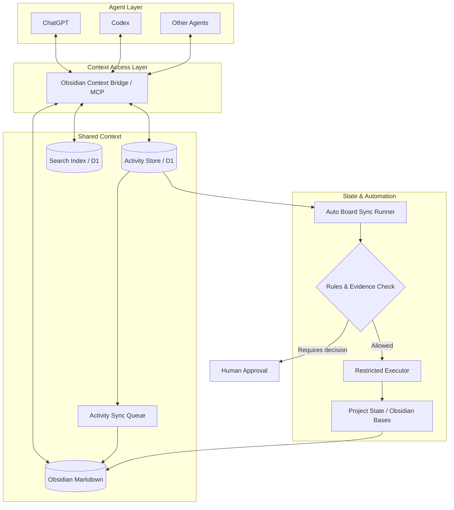
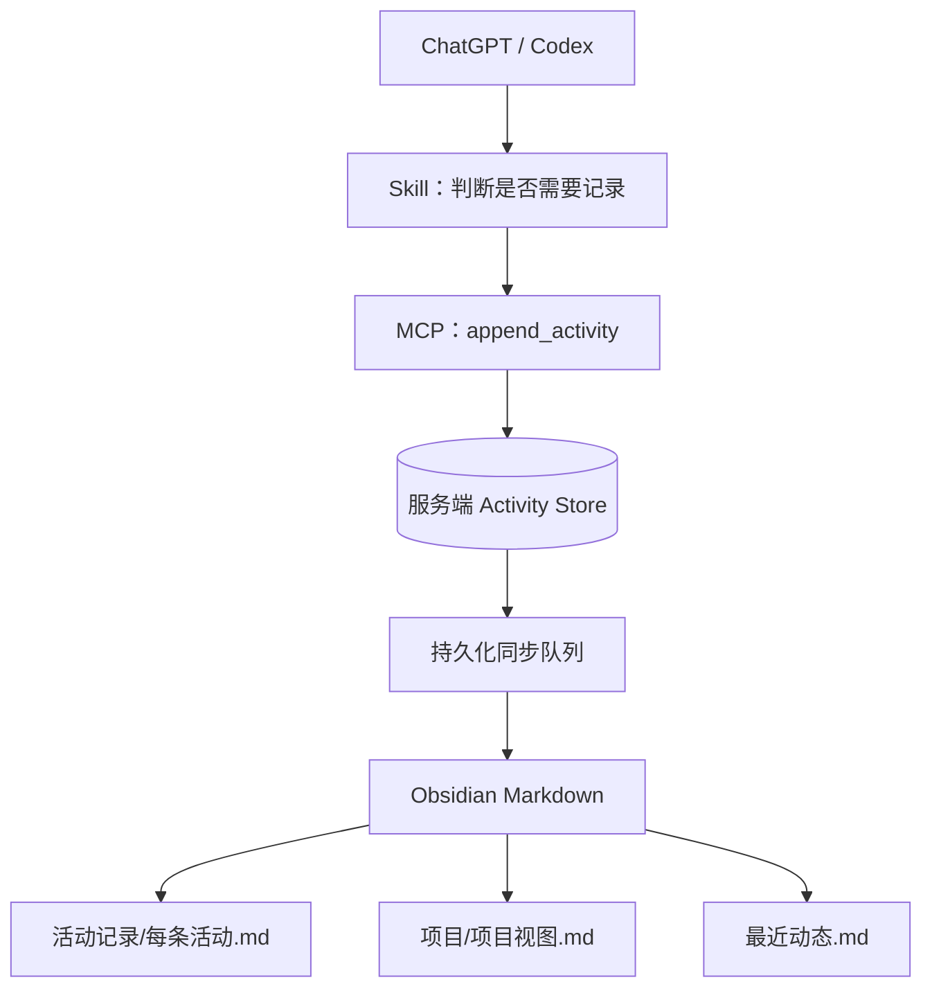

_——从共享工作记录，到让 AI 自动维护我的项目看板_

这个周末，我在尝试解决一个问题：**如何让不同 AI Agent 共享我的个人上下文，并且让这些上下文真正由我自己掌控？**

问题其实很日常：我经常在 ChatGPT 中讨论想法，在 Codex 中开发产品。但是 ChatGPT 不知道 Codex 刚完成了什么，Codex 也不知道我刚刚在 ChatGPT 中做出了什么决定。我总得反复重新解释背景。

更麻烦的是，我同时推进多个项目，问题就更明显了：我要做哪些项目，哪些做完了，发布到什么平台了，有什么反馈，接下来做什么？这些事，坦白地说，我自己也记不清细节。

**我相信，当 AI Agent 越来越多，人不应该继续充当它们之间的上下文连接器。**

而且，长期积累的记忆不应该只存在于某一家 AI 厂商的产品中。

于是，我开始构建自己的 Personal Context。从单个 Agent 的对话中提取有价值的信息，放进由自己维护的长期共享上下文，让不同 Agent 能够访问同一份可追溯的工作记录。

**也就是把 Memory 从单个 Agent 的内部能力，逐步提升为一套个人拥有、跨 Agent 共享的基础设施。**

现在，我已经搭建了一套跨 Agent 共享上下文系统。一个 Agent 可以把开发进展写入共享 Activity Store，另一个 Agent 能在新的会话中读取这些记录并继续工作。

更进一步，我还做了一个自动项目管理器：它会读取 Agent 的活动记录，判断证据是否足够，再更新 Obsidian 中的项目状态，供人了解项目进展。

这次想分享的，一是背后的思考，二是搭建过程中几个关键的设计选择。

## 一、技术全景：把 Context 从 Agent 中摘取

我把整个系统分为五个部分：

1. **Agent Layer**：ChatGPT、Codex 等负责思考、开发和执行任务。
    
2. **Context Access Layer**：通过 MCP 为不同 Agent 提供统一的上下文访问入口。
    
3. **Shared Activity Layer**：记录跨 Agent 的实际工作、决策、证据和下一步。
    
4. **State & Automation Layer**：消费活动事件，维护项目当前状态。
    
5. **Personal Context Storage**：由个人掌控的长期存储，目前使用 Cloudflare D1 保存结构化活动和搜索索引，并通过 Obsidian Markdown 保存可阅读的记录。
    

### 系统架构



这里有两个核心的数据流。

**读取路径：**

Agent 对话 → Skill（判断读取时机与范围）→ MCP → 查询共享上下文 → 返回相关项目状态与历史活动 → Agent 继续工作

**写入路径：**

Agent 对话 → Skill（判断是否需要记录、规范事件内容）→ MCP → Activity Store 持久化 → 同步至 Obsidian Markdown

此外，Auto Board Manager 会定时读取 Activity Store 中的活动，经过证据与权限校验后，更新 Project State。

**Skill 决定什么时候使用上下文，MCP 负责访问上下文，Activity Log 记录发生过什么，Auto Board Manager 根据证据维护当前状态。**

## 二、Context Bridge：让不同 Agent 访问同一份上下文

第一步，是解决不同 Agent 如何把信息存入同一个地方并消费的问题。

我原本就在使用 Obsidian 保存长期笔记，所以没有再引入一个新的笔记平台，而是选择通过 MCP 将现有数据暴露给 Agent。

项目是 [Obsidian Context Bridge](https://github.com/henrymeihao/obsidian-context-bridge)。

### Context Bridge 具体怎么做？

当前实现以坚果云 WebDAV 进行文件存储，使用 Cloudflare Workers 提供 MCP 服务。

主要包括：

- `list_context`：浏览笔记目录。
    
- `search_context`：检索笔记正文。
    
- `read_context`：读取原始 Markdown，返回文件路径和行号。
    
- `get_activity_context`：读取最近的跨 Agent 活动。
    
- `append_activity`：追加结构化的共享活动记录。
    

其中，基础笔记检索与共享活动使用了不同的实现方式。

普通 Markdown 笔记通过 WebDAV 读取，Cloudflare D1 保存可重建的搜索索引。

而跨 Agent 的 Activity 有独立的持久化存储与同步队列，可以直接读取最近活动，不必等待全文索引完成。

活动最终也会同步为 Obsidian 中可阅读的 Markdown。

### 为什么选择 Obsidian，而不是直接使用 Agent 的 Memory？

这里的选择并不只是因为我习惯用 Obsidian。

我更看重两个特性。

**第一，数据所有权。**

Markdown 是开放格式。即使未来更换 Agent、MCP 服务或笔记软件，原始记录仍然可以迁移和阅读。我不希望长期积累的上下文只能在 ChatGPT 内使用，或者只能在 Codex 中生效。

**第二，人和 AI 都能消费。**

我可以在 Obsidian 中查看、整理和纠正记录，Agent 则可以通过 MCP 查询它们。

## 三、Shared Activity：不同 Agent 应该交换什么？

能存和读以后，第二个问题是：**不同 Agent 究竟应该共享什么？**

最直接的方案是同步完整聊天记录。

但我最终没有选择这条路。

因为聊天里混杂着大量探索、建议、假设和临时想法。如果全部写入长期记忆，后续 Agent 很容易把讨论过的内容误认为已经决定的事情。

所以我选择让 AI 自行总结出结构化 Activity Event，作为跨 Agent 的主要交接单位。

### 一条 Activity 记录什么？

一条 Activity 类似这样：

```json
{
  "event_id": "demo-001",
  "project": "weather-card",
  "task_id": "frontend",
  "agent": "Codex",
  "kind": "result",
  "evidence": "observed_action",
  "status": "completed",
  "summary": "天气卡片页面已完成并通过测试",
  "next_step": "交给 ChatGPT 评估发布方案",
  "sources": ["tests/frontend-report.md"]
}
```

这里有几个重要的设计判断。

每条活动主要包含五类信息：

- **身份与关联**：`event_id`、`project`、`task_id`，用于唯一识别事件并关联项目。
    
- **执行上下文**：`agent`、`session_ref`、`occurred_at`，记录哪个 Agent、在哪次会话、什么时候产生了活动。
    
- **事实分类**：`kind`、`evidence`、`status`，区分讨论与结果、建议与实际操作，以及活动报告的状态。
    
- **工作内容**：`summary`、`details`、`next_step`，记录实际发生的事情和后续行动。
    
- **证据与产出**：`sources`、`artifacts`，保留原始依据和交付物位置。
    

持久化后，系统还会记录 `recorded_at`、`vault_synced` 和 `path` 等信息，用于跟踪写入时间、Obsidian 同步结果及原始记录位置。

这里最关键的设计，是将 **事件类型、证据类型和完成状态分离**。

例如，Agent 提出一个建议，可以记录为 `kind=discussion`、`evidence=assistant_proposal`、`status=discussed`。

而一项经过实际验证的交付，可以记录为 `kind=result`、`evidence=observed_action`、`status=completed`。

这避免了将「AI 建议我做」「我决定要做」「已经完成」混为一谈。

### Activity 的存储和消费

Activity 并不是简单地作为 Markdown 文件逐条写入一个文件夹。

**Activity 首先由 MCP 服务端持久化，再通过同步队列写入 Obsidian Markdown；同时生成按项目和最近动态组织的阅读视图。**

在存储层，每条活动都有独立的事件记录，保留来源、时间、执行者、任务和实际结果。

在阅读层，系统又根据这些事件生成两类视图：一类按项目聚合，另一类展示跨项目的最近动态。

这样，Agent 可以按项目获取上下文，而我也可以直接在 Obsidian 中查看整个系统最近发生了什么。

这些视图不应该成为另一套需要手动维护的事实来源。真正的历史依据仍然是原始活动，项目视图可以从活动重新生成。

此外，我还有独立的 Builder & Writer 项目管理看板。Auto Board Manager 消费活动并验证条件后，才会更新其中的项目状态。



## 四、Activity 与 State 分离：为什么不让 Agent 直接修改看板？

**Activity 是不可变的历史事件，Project State 是根据历史证据计算和维护的当前状态。**

假设一个项目要完成开发，然后分别发布到 GitHub 和 X。

Codex 提交了代码，只能说明开发有进展。

GitHub 已经发布，也不意味着 X 的发布完成。

如果每个 Agent 都根据自己的局部信息修改项目状态，就很容易出现误判。

### Auto Board Manager 如何工作？

当前本地工具主要分为三个模块。

**1. Sync Runner：采集活动**

从 Context Bridge 分页读取活动，使用 SQLite 保存检查点、待处理事件和去重状态。

**2. Manager：生成更新计划**

根据项目身份、活动内容和已有管理卡，判断哪些事实可以补充，哪些状态变化有足够证据。

**3. Executor：受限执行**

在执行文件修改前重新检查条件，再进行实际写入、目录移动和链接修复。

这种设计有三个好处：

1. **可追溯**：每次状态变化都能找到对应的活动和证据。
    
2. **可恢复**：即使同步失败，也可以根据未处理的活动继续执行。
    
3. **避免冲突**：多个 Agent 不需要直接竞争修改同一张项目管理卡。
    

当然，单个任务的 `completed` 不代表整个项目完成。只有本轮计划的交付内容都得到验证，项目才应该进入下一阶段。

**Agent 负责记录发生了什么，Auto Board Manager 负责判断这些事实是否足以改变项目状态。**

## 五、实际验收：从一个 Agent 写入，到另一个 Agent 接续

目前已经完成了两个真实闭环。

### 跨 Agent 双向读写

第一轮验收：

1. Codex 写入共享活动。
    
2. ChatGPT 在新会话中读取活动和原始记录。
    
3. ChatGPT 写回自己的验证结果。
    
4. Codex 再次读取，并通过 Obsidian 原始 Markdown 核对。
    

两端写入均确认完成同步。

这证明不同 Agent 可以通过同一套 Context Bridge 交换真实工作记录，而不需要共享完整聊天会话。

### 自动项目状态更新

第二轮验收：

1. 独立 Agent 写入共享上下文首版完成验收的活动。
    
2. Sync Runner 采集到新增活动。
    
3. Manager 将活动关联到已有项目。
    
4. Executor 根据明确的交付证据执行状态流转。
    
5. 项目从「制作中」移动到「待反馈」。
    
6. 相关 Obsidian 链接完成修复。
    
7. 再次处理同一事件，没有产生重复修改。
    

这一阶段的自动同步实现通过了 96 项测试，也完成了上述真实端到端验证。

这里的 96 项是本地 Auto Board Manager 的测试，与公开 Context Bridge 仓库的测试属于不同范围。

当前每日自动同步任务已经配置，实际长期稳定性、授权环境和异常恢复仍需要持续观察。

## 六、下一步：从共享工作记录走向个人长期记忆

目前，这套系统主要解决的是跨 Agent 的工作接续问题：记录发生过什么，以及项目现在进行到哪一步。

但 Activity 不等于 Memory。在我看来，Activity 是历史记录，Memory 则是从长期经历和交互中保留下来的、对未来仍然有用的信息。

- Activity：发生过什么。
    
- Memory：哪些信息值得长期保留。
    
- Context：当前任务需要使用哪些信息。
    

下一阶段，我希望在现有共享上下文之上增加三项能力。

### 1. Unified Memory：定义统一的个人记忆结构

首先，需要区分不同类型、不同生命周期的信息，并分门别类存储和消费。

例如：

- **Identity**：相对稳定的个人背景。
    
- **Preferences**：长期偏好与协作习惯。
    
- **Decisions**：重要决策及其理由。
    
- **Experience**：项目经验与可复用的方法。
    
- **Working State**：近期目标、任务与临时状态。
    

这些信息不应该全部堆进一个不断膨胀的 `memory.md`。

更重要的是，每条记忆都需要保留来源、确认状态、更新时间和有效范围，避免旧信息长期影响 Agent 的判断。

### 2. Memory Manager：让记忆持续演化

有了统一结构，还需要决定什么值得记住。

例如，「发布了一段五秒钟的动画演示」是一条 Activity。

而「展示视觉作品时，更偏好简短、直观的表达」则可能是一条值得长期保存的 Preference。

但后者属于从行为中提炼的判断，不能直接当作用户明确确认的事实。

Memory Manager 需要从活动、笔记和用户明确表达中提取候选记忆，处理重复、冲突、更新和失效，并在重要个人信息发生变化时请求确认。

### 3. Context Bootstrap：按任务加载真正需要的上下文

即使拥有完整的个人记忆，也不意味着每次会话都应该全部加载。

更合理的方式，是让 Agent 根据当前任务，从 Unified Memory、Project State 和 Recent Activity 中检索、筛选并组装相关上下文。本质上是一个 Context Retrieval 问题。

例如：

讨论开发项目时，优先加载项目目标、近期进展、历史技术决策和开发偏好。

讨论旅行时，则加载旅行偏好、当前计划和预算约束，而不是无关的代码项目。

这里还需要考虑上下文长度、信息时效、冲突处理和访问权限。

最终，我希望形成一个持续运转的循环：

**Agent 工作 → 产生 Activity → 提炼长期 Memory → 新任务按需加载 Context → Agent 继续工作。**

这样，不同 Agent 共享的就不再只是项目进度，而是一套由个人掌控、能够持续演化的长期上下文。

## 七、我最终想构建什么？

回过头看，这个项目最初只是为了解决 ChatGPT 和 Codex 之间反复交代背景的问题。

但我越来越觉得，它背后有一个更长期的方向：

**把个人上下文从 Agent 厂商的产品内部，逐步变成个人拥有、能够跨 Agent 使用的长期资产。**

未来模型会更新，Agent 会变化，工具也会不断更替。

但一个人的经历、决策、目标和积累，不应该因为换了一个 AI，就需要重新开始。

Personal Context 是这套长期状态与记忆的基础设施。

Personal Agent 则是在它之上，能够理解目标、采取行动、获取反馈，并在人的授权下持续协助生活和工作的系统。

---

## 源码与最小实践

如果你也遇到跨 Agent 上下文割裂的问题，我建议先用一个真实项目做最小实验：

准备一份交接记录，包含项目目标、已确认决定、实际完成事项及证据、阻碍和下一步。

让 AI A 完成一项任务并更新记录，再交给 AI B 继续推进，最后返回 AI A 验证。

只有当这个过程真的出现反复交接的成本时，再考虑将记录结构化并自动化。

我已经开源了 Obsidian Context Bridge：

[Obsidian Context Bridge — GitHub](https://github.com/henrymeihao/obsidian-context-bridge)

目前公开仓库包含 Obsidian Markdown 的 MCP 访问、结构化 Activity API、持久化与同步机制，以及 ChatGPT / Codex 的跨 Agent Skills。

Auto Board Manager 目前仍是本地实现，尚未整理成可复用的公开版本。完整的第三方独立部署与双 Agent 验收流程，也还需要进一步验证。

后续我也会继续记录 Personal Memory、Context Bootstrap 和 Personal Agent 的实现过程。
