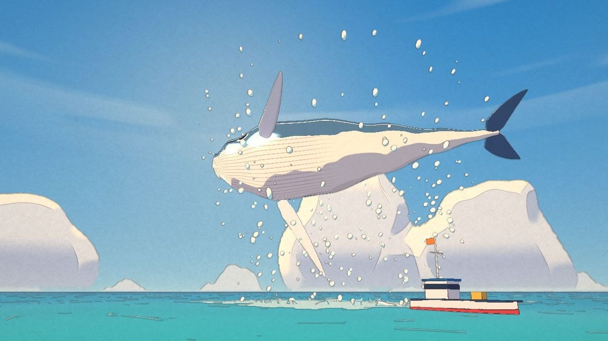
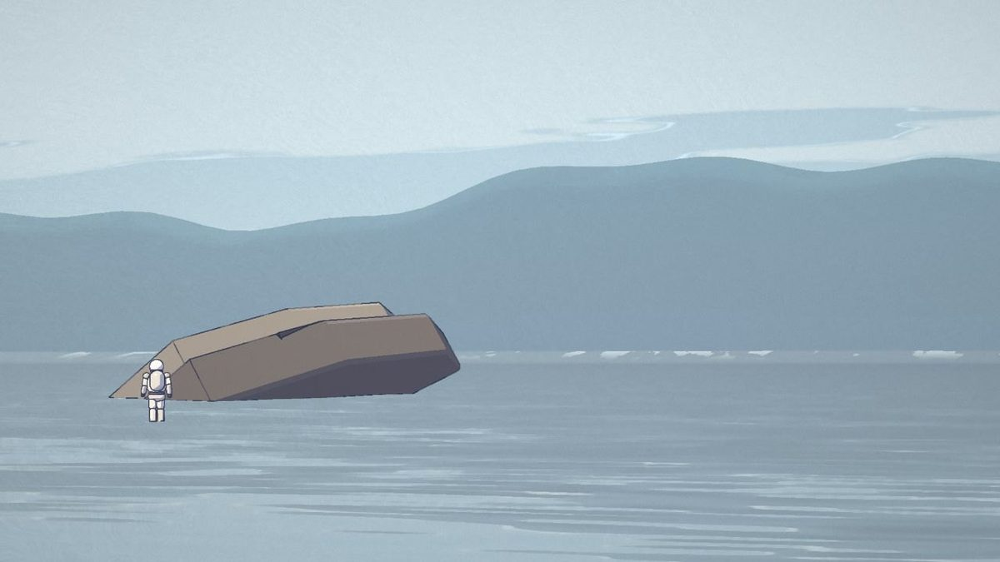
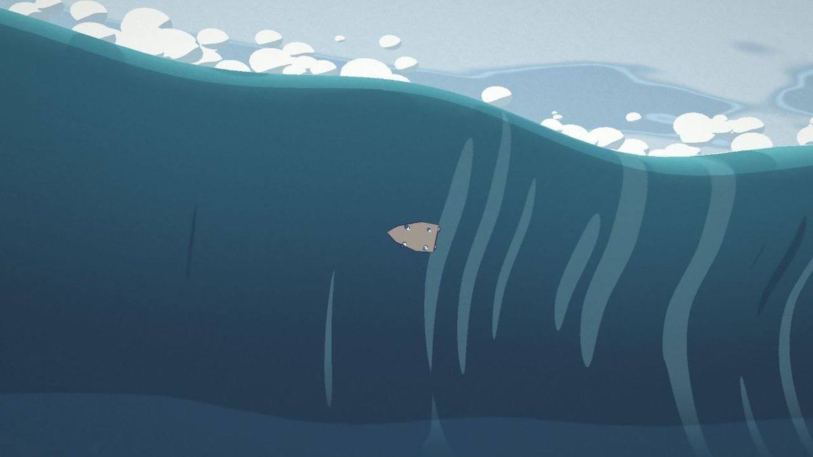
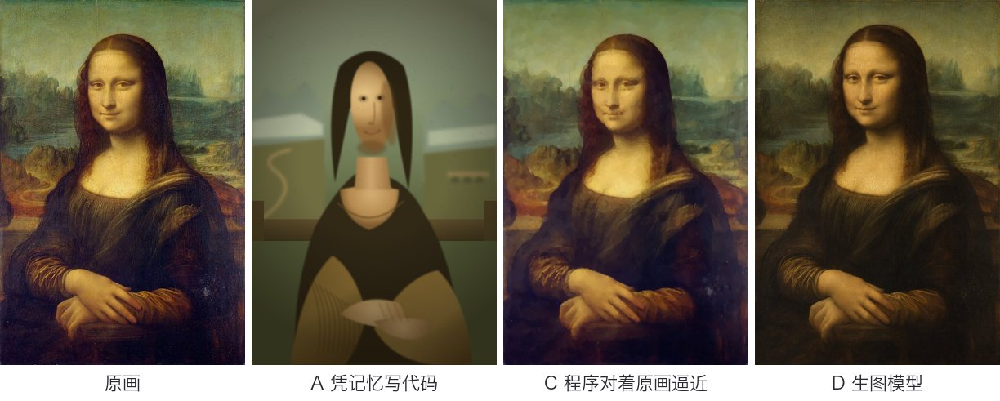

前几天在 GitHub 上看到一个项目，叫 [Leviathan](https://github.com/0xCodez/leviathan)：一部 83 秒的动画短片，巨人拉弓射箭，箭飞进太空又落下来，刺穿一头海怪。看着像认真做出来的动画，其实每一帧都是代码在浏览器里画的，没用视频模型，也没用生图模型，连声音都是代码合成的。

[上一篇](/writing/ai-video-without-drawing-a-frame/)我用这个思路做了一条科普动画。科普动画主要是文字和图表，这次我想试试更难的：动画片。我只让 AI 写代码，不让它调任何生成模型，看看能做到什么程度。

## 做了什么

### 鲸鱼

第一部是一头鲸鱼跃出水面，5 秒。后来我又让 AI 把它改成手绘动画的画风：积云、水彩一样的海、细细的彩色线条，配一小段钢琴。



[在线观看](https://henrymeihao.github.io/kujira-js/) · [GitHub 源码](https://github.com/henrymeihao/kujira-js)

### 米勒星球的巨浪

第二部是《星际穿越》米勒星球的巨浪，54 秒，23 个镜头。宇航员蹚水，远处有一排“山”，镜头推近，才发现那是浪。机器人 CASE 救人，着陆艇被浪托上去，翻过浪顶。





[在线观看](https://henrymeihao.github.io/miller-planet-js/) · [GitHub 源码](https://github.com/henrymeihao/miller-planet-js)

两部都是一个 HTML 文件，大约 1.4 MB，打开就能放，代码都是一千多行。

## 底层是怎么做出来的

原理和[上一篇](/writing/ai-video-without-drawing-a-frame/)一样：视频其实是一个网页，每一帧都由时间算出来。区别在于，科普动画画的是文字和图表，这次要画一个 3D 世界。

### 一张时间表管全片

代码里有两张表：一张记剧情的时间点，比如第几秒发现那是浪、第几秒浪脚卷走宇航员；一张记 23 个镜头各从第几秒到第几秒。每个镜头配一个函数，输入“这个镜头开始了几秒”，输出机位、朝向和焦距。宇航员、机器人、着陆艇和浪也一样，位置都是时间的函数。简化后大概是这样：

```js
// 给一个帧号，算出这一帧里的一切
function stateFor(frame) {
  const t = frame / 24;                  // 第几秒
  const shot = shotAt(t);                // 属于哪个镜头
  return {
    cam: CAMS[shot.id](t - shot.start),  // 机位
    ranger: rangerAt(t),                 // 着陆艇在哪、怎么倾斜
    wave: WAVE.z(t),                     // 浪推到了哪里
  };
}
```

需要随机的地方，比如水花和云的形状，都用固定的种子生成，每次结果都一样；也不依赖上一帧的结果。所以任何一帧都能单独算出来。拖进度条，就是直接跳到那一帧去算。

### 画面是 three.js 搭的 3D 场景

没有模型文件，也没有贴图。天空是一个大球，颜色和积云由着色器现算，着色器就是在显卡上逐个像素运行的小程序。海面是一张网格，起伏也在着色器里算。巨浪是一条截面曲线，沿着海平线横扫十公里，按时间推进并重算形状，远处加上雾就像一排山。宇航员用胶囊体、球和方块拼起来，关节是一层层嵌套的旋转，走路就是让大腿和小腿按正弦曲线来回摆。

### 再加几道处理，把 3D 画成画

每一帧先渲染出两张图：一张是颜色，另一张记下每个像素的朝向、远近，以及它属于哪个物体。然后背景用 Kuwahara 滤镜抹成水粉笔触，物体边缘、远近突变的地方描上墨线，亮处加一层光晕，最后统一调色、加颗粒。人物和浪的动作每秒只更新 12 次，看起来就像手绘动画。

### 声音在打开页面时合成

用浏览器自带的 Web Audio，在后台把整段 54 秒的声音一次渲染成一段音频：滴答声、蹚水声、浪的低频、管风琴和弦。每个声音的时间点都对着那张剧情时间表，所以和画面天然对齐。

### 播放就是不停地问“现在第几秒”

播放器以音频的播放进度当时钟，屏幕每刷新一次，就算出当前是第几帧，再把那一帧画出来。画面跟着声音走，偶尔卡一下也不会音画错位。

### 打包成一个网页

构建脚本把 three.js、着色器和全部代码塞进一个 HTML 文件，大约 1.4 MB，放到 GitHub Pages 上就能在线看，下载下来也能离线放。要导出成 MP4，就和上一篇一样：用无头浏览器逐帧调用、截图，再用 FFmpeg 拼起来。

## 代码画不了什么

我还做了一个对照实验：让 AI 用几种方法画同一幅《蒙娜丽莎》。



- **凭记忆一次写出绘图代码：** 构图大致对，脸像简笔画。
- **写一段一百多行的程序，对着原画一笔一笔逼近：** 很像，而且计算全在浏览器里完成，不花模型的钱。但它只能把已有的图重画一遍，凭空画不出新图。
- **直接用生图模型：** 一段文字描述，就得到一张写实的油画。

结论很清楚：要凭空生成写实画面，代码替代不了生成模型。同样的道理，短剧这类需要真人表演的内容，用代码做也很难办，哪怕不要求像真人。每个新角色、每个新动作都得重新写一遍。

## 真的便宜吗

我一开始以为，用代码做视频会比 AI 视频便宜得多：渲染都在自己的电脑上，一分钱不花。做完一算，并不是这样。

钱不花在渲染上，花在写代码的过程里。查了 Codex 记在本地的用量，米勒星球三个版本加起来，输出只有约 9 万 token，输入却有约 3570 万。AI 每改一次代码、截一张图看效果，都要把整段对话重新读一遍，对话越长，每改一次就越贵。按常见大模型每百万输入 token 1 到 5 美元的价格粗算：如果大部分输入命中缓存、按一折计费，这部 54 秒的片子大约要几美元到二十美元；不命中的话，会到几十甚至一百多美元。实际金额以账单为准。

再看 AI 视频：主流模型每秒大约 0.03 到 0.4 美元。54 秒要拆成几段生成，每段再重试几次，估下来也是十几到一百多美元。两边差不多是一个量级。只做一条片子的话，写代码并不比 AI 视频便宜，还更费工夫。

两边贵的其实都是迭代：AI 视频每重试一次付一次钱，代码每改一次也付一次钱。真正的差别在定稿之后。代码可以一直复用，再出一个竖版、英文版、4K 版，或者换一段文案再做一条，几乎不花钱；AI 视频每多一秒、每换一次内容，都要重新付费。

## 什么适合用代码做

两条线就能大致分开：要不要写实，同一套东西要复用多少次。不要求写实、又要反复用的，比如宣传片、科普片、数据可视化、风格化的系列动画，适合用代码做。要真人、要写实、只做一次的，交给 AI 视频。两头都沾的，可以结合着来：用生图模型出几张角色和场景图，镜头运动、字幕和转场交给代码。
