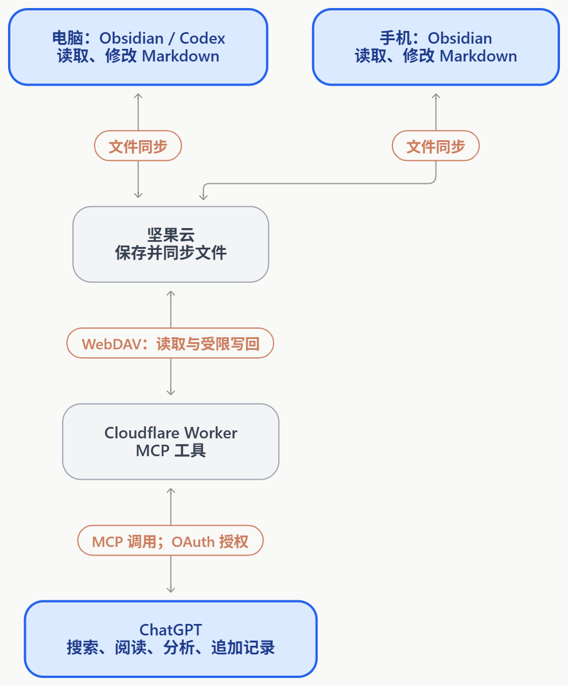

在 AI 时代，我们的个人上下文分散在很多地方，想要统一收集起来并不容易。

比如在手机或者网页上跟 ChatGPT 讨论，相关背景留在对应的聊天和账号里。在个人电脑上使用 Codex，又有本地的文件和对话记录；换到工作电脑，还会有另一套工作上下文。这些内容分散在不同入口，很难让不同的 Agent 看到同一个我。

我想解决的痛点就是这个：**Agent 能不能把值得保留的新上下文写入同一个地方，下一个 Agent 也按需找到并使用它们，接着之前的讨论往下走。**

而且，我维护着一个 Obsidian 笔记库。过去四年里，我不断往里面记录日记、想法、文章和项目资料，它在某种程度上能代表我的个人上下文。

我想，既然自己的背景、想法和项目记录，已经持续写在一个地方了，是不是可以让 Agent 也往里面保存内容，并按需使用这些资料。

为了补上这条连接，我和 Codex 讨论了几种方案。

- 最直接的是继续复制粘贴、上传文件。这种方式适合围绕几份材料做一次讨论，但后续每次资料更新，都需要重新交过去。找什么、传什么，主要还是由我来完成。

- 也可以在个人电脑上运行一个本地服务，通过 Tunnel 暴露给 ChatGPT。它方便开发调试，也能直接访问本地文件。不过，电脑需要保持开机，服务和隧道也要维持运行。手机上临时想查一篇笔记时，这个依赖就不太方便。

- 再往前一步，是买一台 VPS，把服务部署上去。它可以长期在线，但也多了一台需要维护的服务器。我当前只是想让 ChatGPT 读取已有笔记，还不想为此承担这部分维护工作。

- 讨论中还考虑过 GitHub 私有仓库中转：把笔记同步过去，再通过 GitHub 连接器访问。但手机上的 Obsidian 处理 git conflict 非常费劲，我之前也为此放弃了 Git 同步逻辑。

这些方案并非技术上做不到，只是各自增加了手工操作、设备依赖或维护成本。而我已经有一个现成前提：**Obsidian 在手机和电脑之间的同步由坚果云负责，可以先在这条链路上补一个 ChatGPT 能访问的入口。**

## 方案

最后采用的方案，是在 Cloudflare Workers 上部署一个个人 MCP 服务，作为 ChatGPT 和坚果云之间的桥接。

坚果云继续负责电脑、手机之间的文件同步。在这个链路的基础上，Worker 收到请求时执行代码，读取云端文件，或在获得相应授权后追加记录，再把结果返回给 ChatGPT。个人 Codex 仍然可以直接操作本地 Obsidian 文件夹。

这样不用购买 VPS，也不需要为了 ChatGPT 查笔记而让个人电脑一直开机。整体的修改、同步链路也跟之前一致，不需要改变使用习惯。

MCP 在这里负责描述和提供工具：有哪些操作、需要什么参数、返回什么结果。ChatGPT 根据问题选择工具，实际的文件读取和受限写回由 Worker 执行。

## 实施

具体代码、测试和部署主要交给 Codex。我负责确认需求、完成账号授权，再用自己的笔记验证效果。整个过程分了几步：

1. **先读通一篇笔记。** 确认 ChatGPT 支持添加自定义 MCP 服务，再部署 Worker，配置 OAuth 和坚果云 WebDAV，用一篇测试笔记验证连接。之后在电脑上修改内容，再让 ChatGPT 读取，确认同步链路正常。
    
2. **扩展到整个笔记库。** 支持逐层浏览目录、按文件名查找，以及搜索笔记正文。正文搜索支持关键词、常见正则、大小写、目录和文件名模式过滤，返回命中片段及前后文。
    
3. **支持按需读取和核对。** 可以读取笔记正文，也可以按行范围或分段读取长文。搜索和读取结果包含文件路径、行号及时间信息，让 ChatGPT 的归纳有出处可查，需要时还能回读云端原文。
    
4. **让搜索索引自动更新。** 用 Cloudflare D1 保存可重建的正文索引，首次纳入当时库里的 584 篇 Markdown，随后增量检查云端变化。也提供索引状态查询，可以查看收录数量和更新进度。搜索存在更新延迟，需要确认最新内容时，直接读取云端文件。
    
5. **开放受限写回。** 先从饮食记录开始：获得额外授权后，ChatGPT 可以向《饮食记录.md》追加内容，再同步回电脑和手机。写入会检查文件版本，并识别重复请求，避免覆盖其他端的修改或重复记录。
    
6. **明确访问边界。** 读取和追加使用不同权限；隐藏配置、回收站及非 Markdown 附件不纳入浏览和搜索。目前没有开放任意文件的覆盖修改和删除。

中间也踩了一些坑，主要是：

- **同步目录弄错：** 测试文件没有放进真正同步的 Obsidian 目录。
- **运行环境差异：** 本地能通过的代码，在 Workers 上需要调整。
- **OAuth 授权失败：** 来源校验、浏览器安全策略和密钥校验等问题叠加，导致连接转圈或出现 Forbidden。
- **工具列表没更新：** 服务部署后，还需要在 ChatGPT 中刷新工具，才能使用新增能力。

## 做成之后

现在，我可以直接让 ChatGPT 去笔记里找材料，读取相关段落，再带着出处参与讨论；也可以在聊天中记录饮食，让内容回到 Obsidian。电脑上的 Codex 则继续直接操作本地 Markdown。

电脑、手机、Codex 和 ChatGPT，开始能围绕同一套资料工作了。以后在一个地方留下的记录，可以成为另一个 Agent 接着讨论的材料，少一些重新翻找和交代背景的过程。
